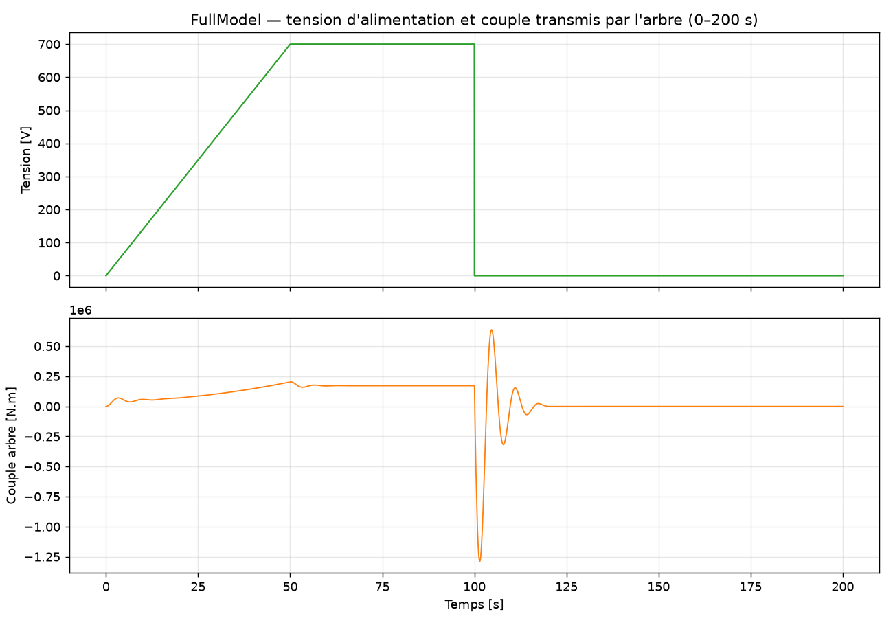
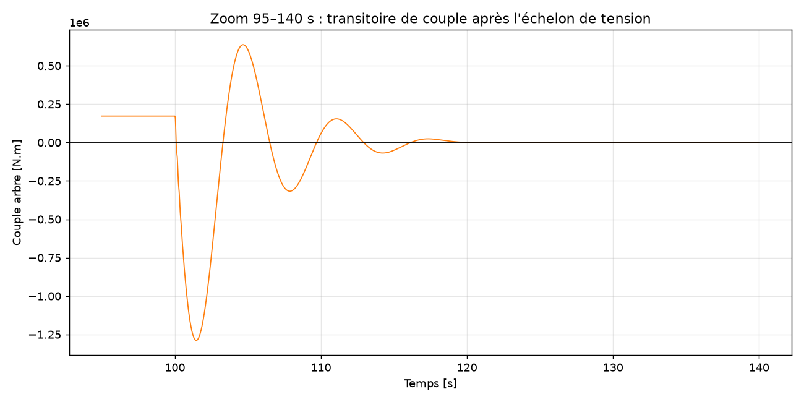
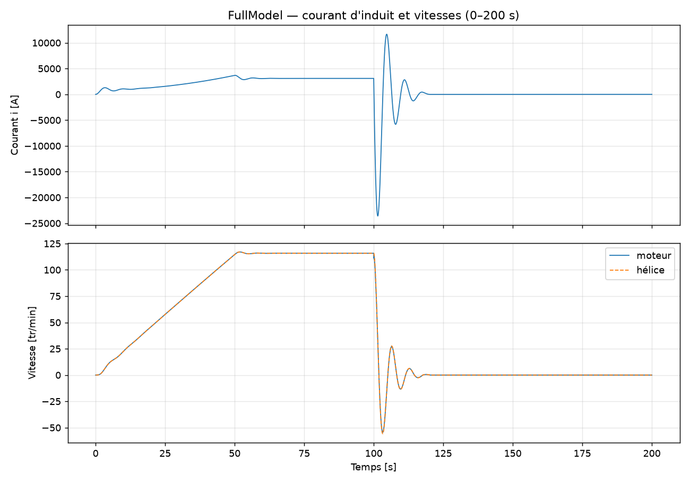

# Simulation transitoire du modèle `SubmarineSTI.FullModel` en Python

Traduction du modèle Modelica `SubmarineSTI.FullModel` (Modelica 3.2.3) en un
script Python autonome utilisant NumPy/SciPy. Le fichier `SubmarineSTI.mo`
contient le modèle d'origine pour référence.

## 1. Description physique du modèle

Le modèle représente la chaîne de propulsion électrique d'un sous-marin :

```
Source de tension (table) ──► Résistance ──► Inductance ──► EMF (moteur DC)
                                                                │
   Bâti ◄── Damper (d=10) ──► Inertie moteur (J=3000 kg·m²) ◄───┘
                                │
                          Ressort/Amortisseur d'arbre (c=6,5 MN·m/rad, d=25 kN·m·s/rad)
                                │
                          Frottement palier (Coulomb, 9000 N·m)
                                │
                          Inertie hélice (J=150 000 kg·m²)
                                │
                          Couple quadratique hélice (charge hydrodynamique)
```

### Composants et paramètres

| Composant Modelica | Paramètre | Valeur | Rôle |
|---|---|---|---|
| `TableVoltage` | table | `[0,0; 50,700; 100,700; 100,0; 150,0]` | Consigne de tension : rampe 0→700 V sur 0–50 s, palier 700 V jusqu'à 100 s, puis 0 V |
| `Resistor` | R = 8 mΩ | 8e-3 Ω | Résistance d'induit |
| `Inductor` | L = 20 mH | 20e-3 H | Inductance d'induit |
| `EMF` | k = 55,7 | 55,7 V·s/rad | Constante de couple / force électromotrice du moteur DC |
| `Inertia` (moteur) | J = 3000 | 3000 kg·m² | Inertie du rotor |
| `Damper` | d = 10 | 10 N·m·s/rad | Frottement visqueux moteur (lié au bâti) |
| `SpringDamper` (arbre) | c = 6,5e6, d = 25000 | 6,5 MN·m/rad ; 25 kN·m·s/rad | Rigidité et amortissement de torsion de l'arbre |
| `BearingFriction` | `tau_pos=[0, 9000]` | 9000 N·m | Frottement de Coulomb du palier hélice |
| `Inertia` (hélice) | J = 150e3 | 150 000 kg·m² | Inertie de l'hélice |
| `QuadraticSpeedDependentTorque` | w_nominal = 120 tr/min, tau_nominal = **+1,75e5 N·m**, TorqueDirection = true | — | Charge hydrodynamique résistive : τ = −τ_nom·(ω/ω_nom)²·sign(ω) |

> **Choix de signe** : `tau_nominal = +1.75e5` (au lieu de `−1.75e5` dans le
> fichier d'origine) avec `TorqueDirection = true` fait de ce composant une
> **charge résistive** conforme à la physique d'hélice : il s'oppose à la
> rotation avec un couple croissant en ω². Avec la valeur négative d'origine,
> l'équation MSL en fait un couple moteur (système stabilisé à 124,4 tr/min
> avec courant négatif).

## 2. Mise en équations

Quatre variables d'état : courant d'induit `i`, vitesses `ω_m` (moteur) et
`ω_p` (hélice), torsion d'arbre `φ_rel` :

```
L·di/dt        = v(t) − R·i − k·ω_m
J_m·dω_m/dt    = k·i − d_m·ω_m − τ_arbre
dφ_rel/dt      = ω_m − ω_p
J_p·dω_p/dt    = τ_arbre − τ_Coulomb·sign(ω_p) − τ_nom·(ω_p/ω_nom)²·sign(ω_p)

avec  τ_arbre = c·φ_rel + d_arbre·(ω_m − ω_p)
```

### Méthode numérique

- Intégration `scipy.integrate.solve_ivp`, méthode **LSODA**, tolérances
  `rtol=1e-8`, `atol=1e-10`.
- L'intégration est **découpée aux discontinuités de v(t)** (fin de rampe à
  t = 50 s, échelon à t = 100 s) pour une bonne précision.
- Le frottement de Coulomb utilise un signe lissé `tanh(ω/ω_eps)` avec
  `ω_eps = 0,01 rad/s` pour la robustesse numérique (comportement quasi
  identique hors voisinage de ω = 0).
- Durée simulée : **200 s**, conditions initiales nulles.

## 3. Résultats

### 3.1 Tension d'alimentation et couple transmis par l'arbre



| Phase | Temps | Tension | Couple arbre |
|---|---|---|---|
| Démarrage | 0–50 s | rampe 0 → 700 V | monte de 0 à ~204 kN·m (surcouple de mise en rotation, max à t = 50 s) |
| Régime établi | 50–100 s | 700 V | **+172 kN·m** (moteur → hélice) |
| Coupure | t = 100 s | échelon 700 → 0 V | **pic de −1,29 MN·m** (t = 101,5 s) puis **+0,64 MN·m** (t = 104,7 s) |
| Retour au repos | ≈ 116 s | 0 V | 0 N·m |

Zoom sur le transitoire de freinage :



### 3.2 Courant et vitesses



### 3.3 Points clés (valeurs numériques)

| Grandeur | Valeur | Commentaire |
|---|---|---|
| Vitesse régime établi (t = 99 s) | **115,8 tr/min** (12,13 rad/s) | moteur et hélice alignés |
| Courant d'induit (t = 99 s) | **3091 A** | cohérent : k·i = 172 kN·m + pertes |
| Couple arbre (t = 99 s) | **172 045 N·m** | = 9000 (palier) + 163 000 (charge ω²) |
| Torsion statique d'arbre | 0,0265 rad | τ/c = 172 045 / 6,5e6 |
| Pic de courant après coupure | −23 600 A | freinage électromagnétique (machine en génératrice sur source court-circuitée) |
| Inversion de vitesse hélice | −55,8 tr/min à t = 103,2 s | rebond élastique de l'arbre |
| Retour au repos | t ≈ 116 s | couple < 100 N·m ; système à l'arrêt ensuite |

### 3.4 Vérifications

- **Équilibre analytique** (résolution par `brentq` de l'équilibre
  électromécanique) : ω = 12,13 rad/s = 115,8 tr/min, i = 3091 A — identique
  à la simulation.
- **Bilan de couple** en régime établi : couple moteur k·i = 172 163 N·m ≈
  charge quadratique + frottement de palier + frottement visqueux moteur.
- Le régime établi (115,8 tr/min) est légèrement inférieur à la vitesse
  nominale (120 tr/min) : la tension de 700 V doit aussi couvrir la chute
  ohmique R·i, ce qui abaisse la force électromotrice disponible.

## 4. Utilisation

```bash
pip install numpy scipy matplotlib
python3 submarine_sti.py
```

Le script régénère les trois figures et affiche les valeurs numériques clés.
La durée de simulation se règle via `simulate_full_model(t_end=...)`.
